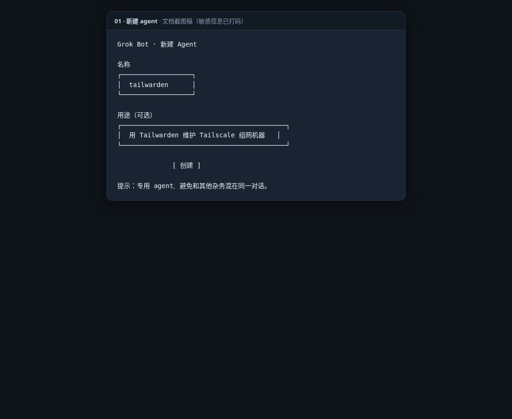
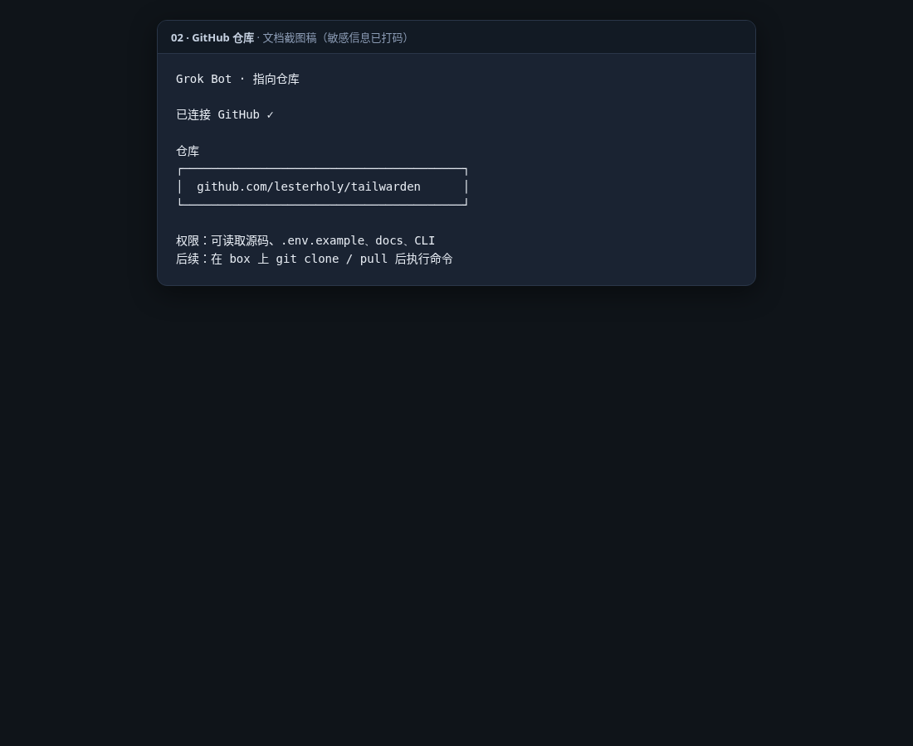
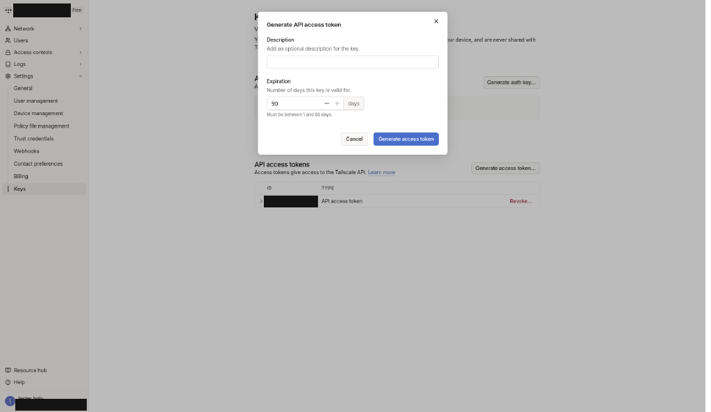
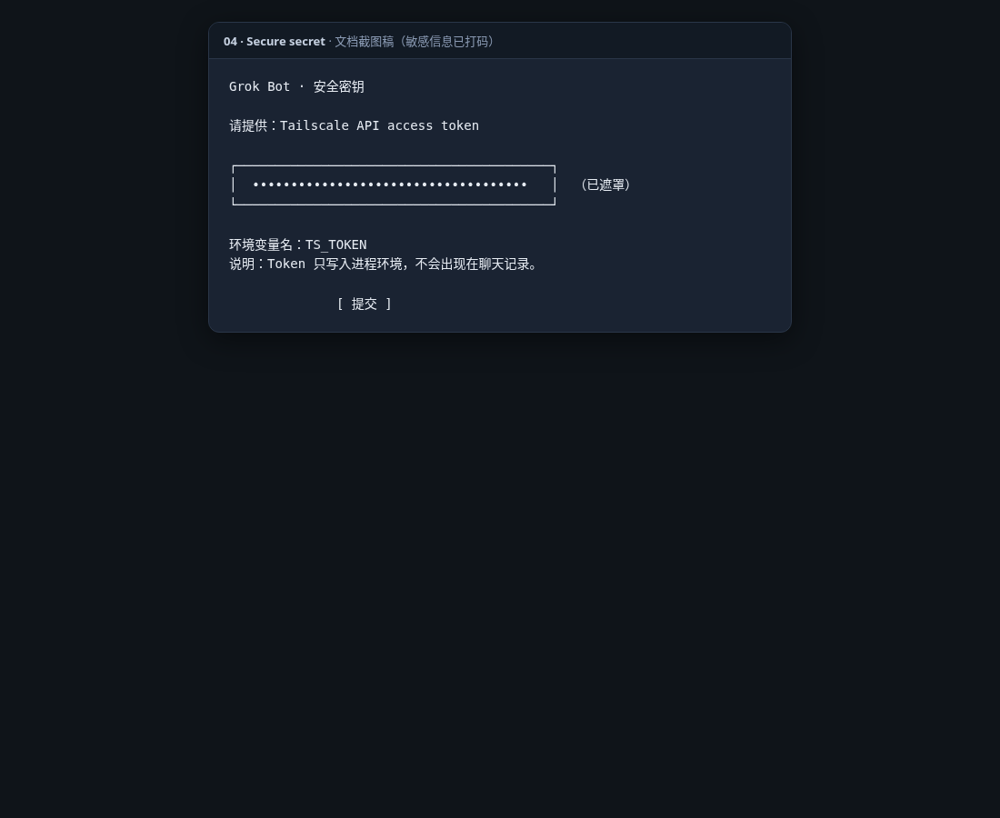
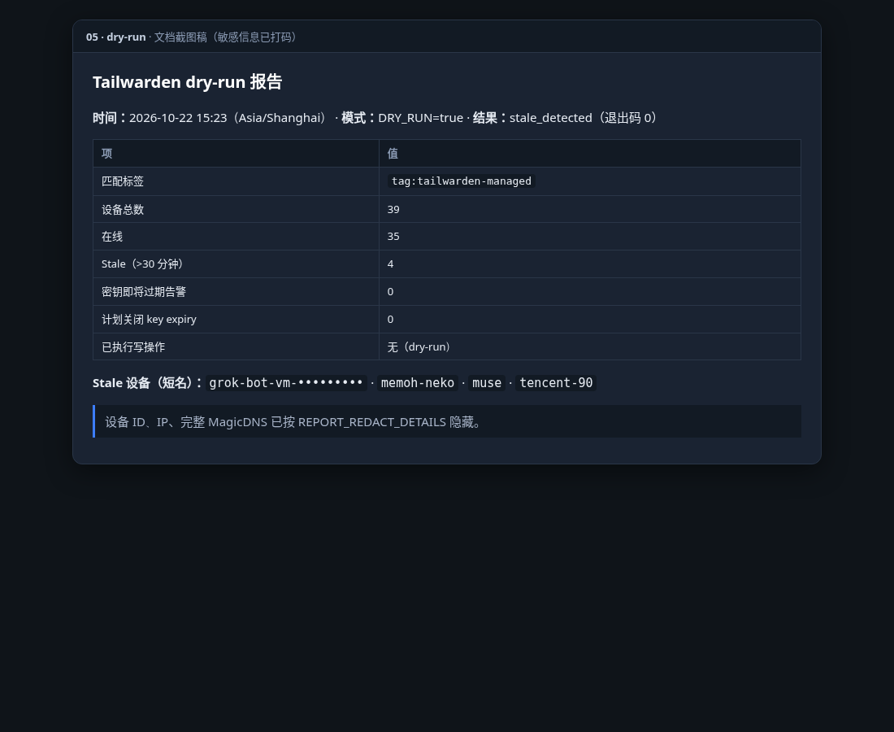
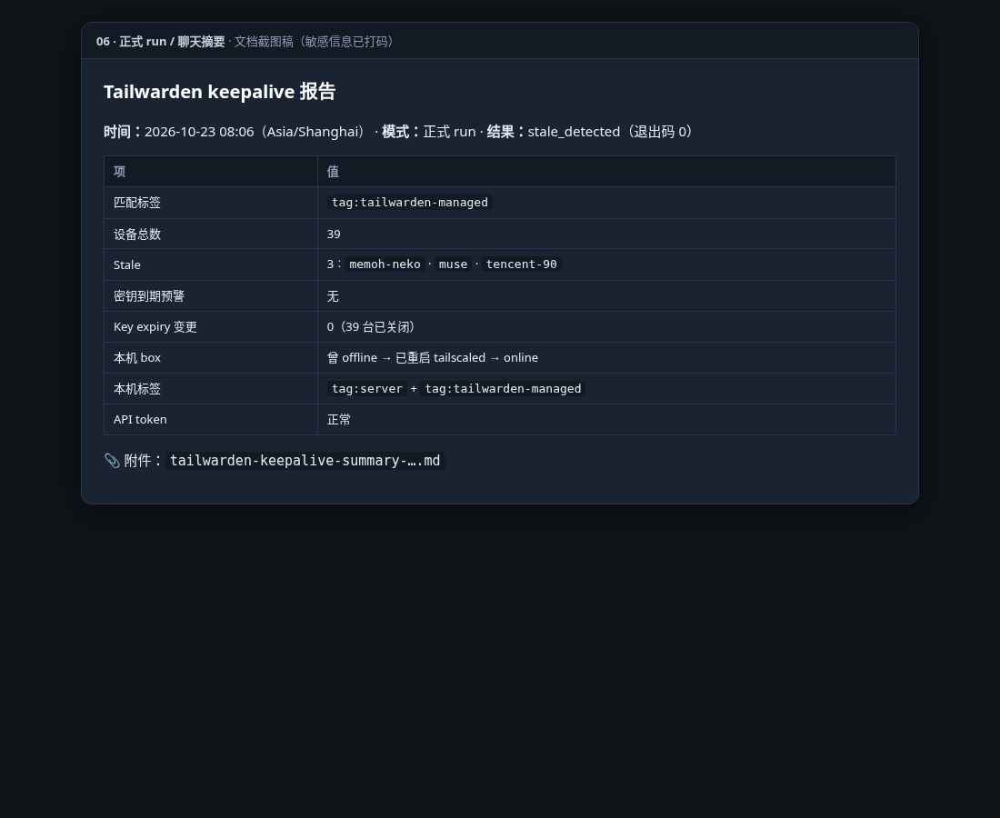
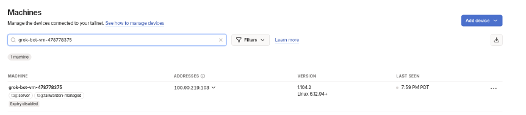
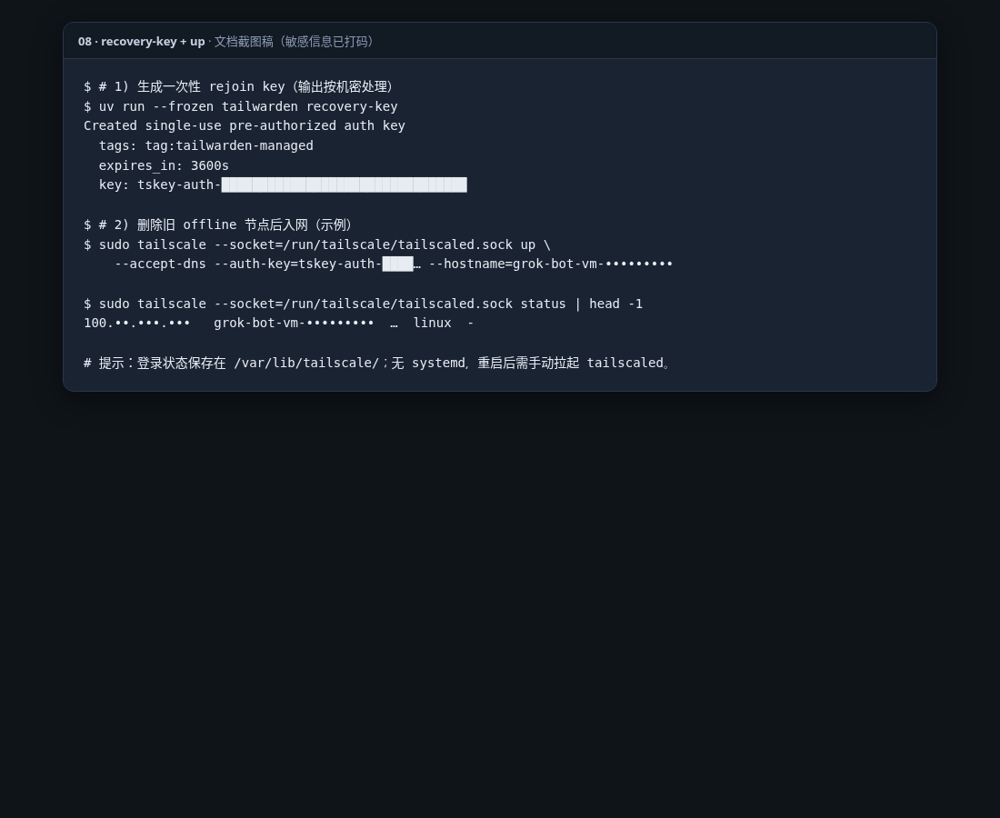
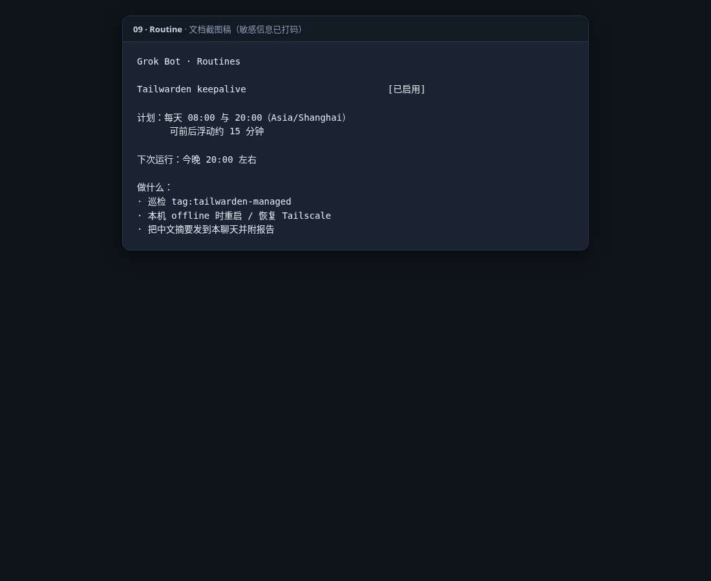
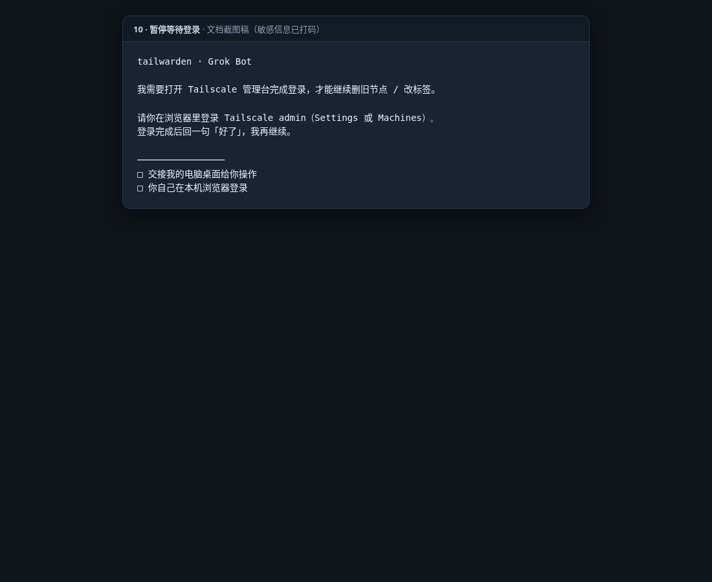

# Tailwarden

[English](README.md) | 中文

用 **Grok Bot** 维护带 Tailscale 标签的机器：定时巡检、报告 stale/offline、按需关闭 device key expiry，并在本机（box）掉线时恢复入网。

本仓库是一个 Python CLI（`tailwarden`）。调度与日常操作建议交给专用的 Grok Bot agent，而不是依赖本仓库内的 GitHub Actions workflow（仓库已不再附带运行用 workflow）。

## 它做什么 / 不做什么

**会做：**

- 按 `SERVER_TAG`（默认 `tag:tailwarden-managed`）选出设备
- 报告 online=false、超过 `STALE_AFTER_MINUTES` 未出现、或 `lastSeen` 缺失的节点
- 对匹配节点关闭 device key expiry（可用 dry-run 只看计划）
- 仅通过显式命令 `recovery-key` 创建一次性 rejoin auth key

**不会做：**

- `run` **不会**创建 recovery auth key（那是 `recovery-key`）
- 不会替你登录 Tailscale 管理台；需要浏览器登录时，Grok Bot 应暂停并请你完成
- 不会自动删除旧 offline 节点；重建 box 后需你（或 bot 在你确认后）在管理台处理

更细的字段与默认值见 [`.env.example`](.env.example) 与 [`docs/tailwarden.md`](docs/tailwarden.md)。

## 用 Grok Bot 的完整流程

### 1. 建一个专用 agent



在 Grok Bot 里新建或打开一个专门负责 Tailwarden 的 agent（例如命名为 `tailwarden`）。把日常巡检、恢复、密钥过期提醒都交给它，避免和其他杂务混在同一个对话里。

### 2. 指向这个 GitHub 仓库



把 agent 指向 [`lesterholy/tailwarden`](https://github.com/lesterholy/tailwarden)。Grok Bot 可通过 GitHub 连接器阅读源码、`.env.example`、文档与 CLI 行为，再在 box 上 `git clone` / `git pull` 后执行命令。

### 3. 鉴权：用 `TS_TOKEN`（不要把 token 打进聊天）





在 **Grok Bot / 本地 CLI** 场景下，使用 Tailscale 管理台 **Settings > Keys** 创建的 **API access token**，通过环境变量 `TS_TOKEN` 提供。

请用 Grok Bot 的 **secure secret 输入** 注入，让 token 永不出现在聊天记录里。Token 最长大约 90 天；到期或权限不足时 API 会返回 401/403，bot 应主动提醒你轮换。

> **给仍在用 GitHub Actions 的读者（简要）：**  
> 代码仍保留可选的 GitHub OIDC 路径（`TS_CLIENT_ID` / `TS_AUDIENCE`，外加 Actions 注入的 `ACTIONS_ID_TOKEN_REQUEST_*`）。该路径只在 GitHub Actions 运行时可用；`GITHUB_ACTIONS=true` 时不会回退到 `TS_TOKEN`，且禁止执行 `recovery-key`。本仓库不再附带调度用 workflow——若你自建 Actions，请自行配置 OIDC 与 Trust credentials。

### 4. 推荐环境变量（Grok Bot 定时巡检）

与常见运维约定一致时，可使用：

| 变量 | 建议值 | 说明 |
|------|--------|------|
| `TAILNET` | `-` | 使用凭据默认 tailnet |
| `SERVER_TAG` | `tag:tailwarden-managed` | 只巡检带此 tag 的设备 |
| `REJOIN_AUTH_KEY_TAG` | `tag:tailwarden-managed` | `recovery-key` 写入的 tag（必须是具体 `tag:…`） |
| `STALE_AFTER_MINUTES` | `30` | 多久未见算 stale |
| `KEY_EXPIRY_WARNING_HOURS` | `168` | key 将在多久内过期时计入告警 |
| `AUTH_KEY_EXPIRY_SECONDS` | `3600` | recovery key 有效期（秒） |
| `FAIL_ON_STALE` | `false` | 定时 bot 跑：有 stale 仍给报告，不以退出码 2「硬失败」打断流程 |
| `REPORT_REDACT_DETAILS` | `true` | 聊天附件里隐藏设备细节 |
| `REPORT_DEVICE_NAMES` | `true` | 摘要里保留短设备名，方便你扫一眼 |
| `DRY_RUN` | 首次 `true`，确认后 `false` | 见下一节 |

> **注意：** 代码 / `.env.example` 里 `FAIL_ON_STALE` 默认是 `true`，`REPORT_REDACT_DETAILS` / `REPORT_DEVICE_NAMES` 默认是 `false`。上表是 **Grok Bot 定时巡检** 的运维建议，不是库的硬编码默认值。单次运行也可用 CLI：`run --no-fail-on-stale`、`run --dry-run` 等覆盖。

在 box 上安装依赖后执行：

```bash
uv sync --frozen
```

### 5. 第一次：先 dry-run，再正式 `run`





```bash
# 只看计划，不改 key expiry
DRY_RUN=true uv run --frozen tailwarden run
# 或
uv run --frozen tailwarden run --dry-run
```

确认匹配设备与计划动作无误后：

```bash
uv run --frozen tailwarden run
# 定时 bot 建议显式关闭「stale 即失败」：
uv run --frozen tailwarden run --no-fail-on-stale
```

**`run` 实际会做的事：**

1. 拉取 tailnet 设备列表，按 `SERVER_TAG` 过滤  
2. 统计 stale / offline / unknown `lastSeen` / 即将过期的 key  
3. 对尚未关闭 key expiry 的匹配节点：dry-run 只记「planned」，否则调用 API 关闭  
4. 打印 JSON 报告（可脱敏）；若存在 `GITHUB_STEP_SUMMARY` 还会写 Step Summary  

**`run` 不会做的事：** 创建 recovery auth key、重启 Tailscale、删节点、改 ACL。

退出码（便于 bot 判断）：`0` 正常；`2` 在启用 `FAIL_ON_STALE` 时表示有 stale/offline；`4` 操作错误；`64` 配置错误。

### 6. 当 Grok Bot 自己的 box 变 stale





主机名常类似 `grok-bot-vm-…`。常见原因：box 重建后 Tailscale 状态被清掉；PID 1 是 `tini`，**没有 systemd**，不能靠 `systemctl restart tailscaled`。

建议顺序（由 bot 执行，敏感步骤先征得你同意）：

1. 确认本机 `tailscale status` / 进程是否还在；没有则重装或重启 Tailscale 守护进程  
2. 需要重新入网时，在受控本地终端执行 `uv run --frozen tailwarden recovery-key`，取回**一次性** auth key（勿写入聊天全文或公开日志）  
3. 在管理台删除旧的 offline 同名节点，避免冲突  
4. 加入网络，例如：  
   `tailscale up --accept-dns --hostname=<期望主机名> --auth-key=<recovery-key>`  
5. 若 ACL 需要 `tag:server`，在管理台把节点标签恢复为 **`tag:server` + `tag:tailwarden-managed`**（`recovery-key` 只会带上 `REJOIN_AUTH_KEY_TAG`，通常是后者）  
6. 接受 IP 可能变化；依赖旧 IP 的防火墙或脚本要一并更新  

`recovery-key` 创建的是带 `REJOIN_AUTH_KEY_TAG`、预授权、不可复用、按 `AUTH_KEY_EXPIRY_SECONDS` 过期的 auth key。用完即废；API access token 也建议用短生命周期。

### 7. 定时：一天两次，而不是 GitHub cron



用 Grok Bot **routine** 在 **Asia/Shanghai** 的 **08:00** 与 **20:00** 各跑一次（替代仓库里曾经的 GitHub Actions cron）。每次运行建议：

- 执行 `tailwarden run`（配合上一节的 env）  
- 把摘要发到聊天，并附上报告附件  
- 若本机 Tailscale 已 offline，先尝试自动重启 / 重装并按第 6 节恢复，再巡检  

### 8. Token 过期与 401/403

API access token 最长约 90 天。若巡检出现 **401 / 403**，bot 应明确告警「`TS_TOKEN` 可能过期或权限不足」，并引导你用 secure secret 输入轮换新 token——不要把新 token 贴进对话。

### 9. 需要浏览器登录时：暂停，交给你



删除旧节点、改标签、确认设备列表等操作有时必须打开 Tailscale 管理台。此时 Grok Bot 应**停下**，请你在浏览器完成登录（可交接桌面或由你自行操作），完成后再继续自动化步骤。

## 常用命令速查

```bash
uv sync --frozen
uv run --frozen tailwarden run --dry-run
uv run --frozen tailwarden run --no-fail-on-stale
uv run --frozen tailwarden recovery-key   # 仅受控终端；输出按机密处理
```

本地开发检查：

```bash
uv sync --frozen --group dev
uv run --frozen ruff check .
uv run --frozen ruff format --check .
uv run --frozen pytest
```

## 安全

- 永远不要把 `TS_TOKEN`、recovery key、OIDC JWT、完整设备 ID 贴进公开 issue / PR / 聊天  
- 泄露后先在签发方撤销，再轮换相关凭据  
- 漏洞请按 [安全策略](.github/SECURITY.md) 私密报告  

## 许可证

[MIT License](LICENSE)
